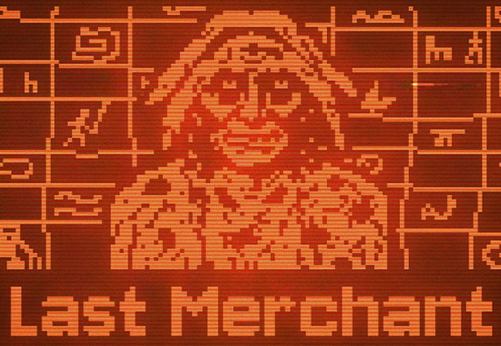
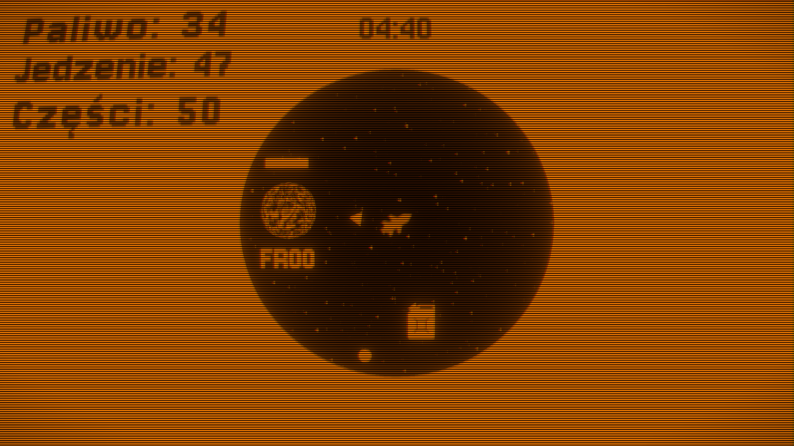
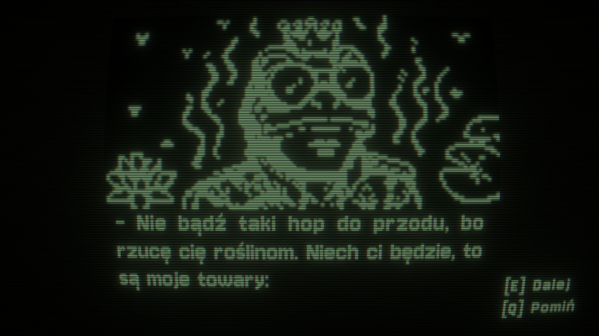
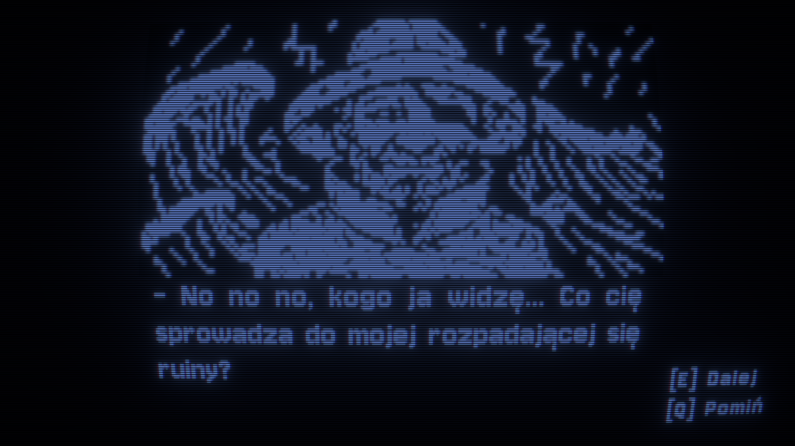
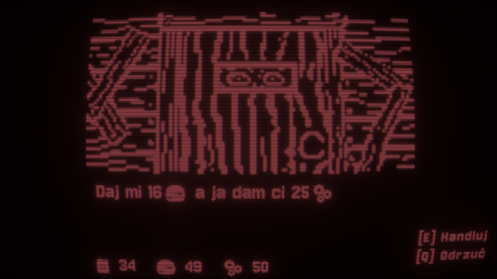

# Last Merchant

**A game created in 24 hours during a game jam as part of the nationwide Cyberiada 2025/2026 project**

You are the last human who can stop the final collapse of galactic civilization. Forgotten planets drift in the dark, inhabited by bizarre creatures. Your task is to keep them alive through strategic barter trading. Every second of delay brings the galaxy closer to extinction. Gather supplies, demonstrate spatial orientation, and survive until the end of time.

[Play on itch.io](https://cursedcodegames.itch.io/last-merchant)

---

## About the Game

### Strategic Barter Trading
Exchange resources with creatures inhabiting forgotten planets. Every transaction is crucial, and proper resource management is the only way to stop the collapse of civilization.

### Procedural Void Exploration
Traverse a dark, randomly generated space void. Each playthrough offers a unique layout of territories, forcing constant adaptation to new conditions.

### Demanding Planning
Finding your way back in the infinite void depends solely on your navigation skills. Time is running out, and spatial miscalculations can cost the life of the entire galaxy.

### Unique Retro Graphics
The game features a raw, retro style reminiscent of classic computer terminals, amplifying the feeling of isolation and desperation in the void of space.

---

## Gallery

  
  

  
  

---

## Technical Information

| Feature | Details |
| :--- | :--- |
| **Engine** | Unity |
| **Genre** | Arcade |
| **Platform** | Windows / WebGL |
| **Version** | v2.0 |

---

## About the Project

The game was created by the **CURSED CODE** team in just 24 hours during a game jam as part of the student project Cyberiada 2025/2026. The theme of the event was "The last human nearby".  
Cyberiada is a nationwide educational project and a competition for game developers. Over the course of the 8-month competition, 40 teams from all over Poland participated in workshops, programming challenges, and intense game jams. The project tested agile teamwork and effective communication under time pressure.

---

[Download the game on itch.io](https://cursedcodegames.itch.io/last-merchant)

